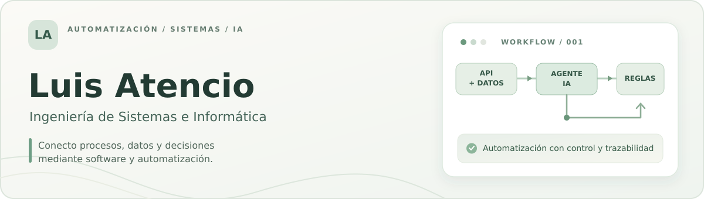
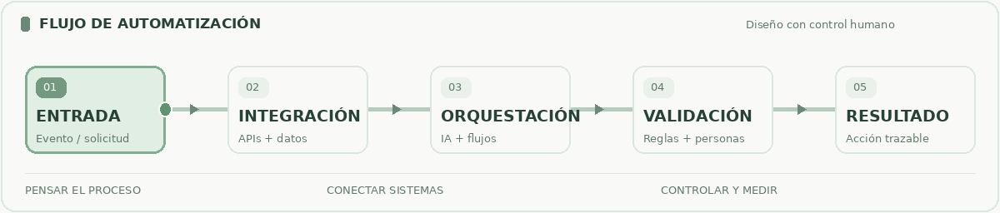

  

  
  
  

## Hola, soy Luis 👋

Soy **Luis Atencio**, profesional del ámbito de la Ingeniería de Sistemas en Perú. Me enfoco en la **automatización de procesos**, el desarrollo de software, la **inteligencia artificial aplicada** y la integración de sistemas.

Me interesa diseñar soluciones que no solo ejecuten tareas: que **conecten información, reduzcan trabajo repetitivo y permitan tomar decisiones con trazabilidad**. En procesos sensibles, priorizo reglas claras, validaciones y supervisión humana sobre una automatización sin controles.

> **Mi enfoque:** entender el proceso → integrar los sistemas → automatizar lo repetible → validar lo importante → medir el resultado.

## ⚙️ Mi enfoque de automatización

  

Trabajo en la intersección de **software, datos y procesos**, combinando servicios y APIs, orquestación de flujos, agentes de IA y automatización robótica cuando el caso lo requiere.

## 🚀 Proyectos destacados

### 01 / BankOps AI · Automatización de operaciones bancarias

**Prototipo de investigación y atención de reclamos por transferencias**, que combina reglas de negocio deterministas, análisis asistido por IA, revisión humana y RPA para tareas administrativas autorizadas. Incluye registro de eventos y evidencia para seguimiento; utiliza **datos bancarios sintéticos**.

**Arquitectura:** `n8n` · `OpenAI` · `Python / FastAPI` · `PHP` · `IBM Db2` · `Power Automate Desktop`

**Decisión de diseño:** la IA puede asistir en el análisis, pero no autoriza ni ejecuta movimientos financieros de forma autónoma.

[**Explorar repositorio →**](https://github.com/FCode19/bankops-ai)

---

### 02 / AVIP · Asistente Virtual Inteligente de Praga

**Plataforma de agentes inteligentes aplicada a procesos administrativos**, con asistentes especializados, consultas documentales mediante **RAG** y acceso controlado a datos estructurados a través de APIs. Su documentación incluye una evaluación comparativa de procesos *AS IS / TO BE*.

**Arquitectura:** `Flowise` · `OpenAI` · `RAG` · `PHP / APIs` · `MariaDB` · `JavaScript / Bootstrap`

**Decisión de diseño:** separar los agentes, las APIs de integración y la base de datos para evitar el acceso directo del modelo a información transaccional.

[**Explorar repositorio →**](https://github.com/FCode19/avip-intelligent-virtual-agents-praga)

## 🧩 Tecnologías con las que trabajo

| Área | Tecnologías y enfoques |
| :-- | :-- |
| **IA y orquestación** | OpenAI · n8n · Flowise · agentes de IA · RAG |
| **Backend e integración** | Python · FastAPI · PHP · REST APIs · JSON |
| **Datos** | MySQL · MariaDB · IBM Db2 · SQL |
| **Automatización RPA** | Power Automate Desktop · flujos con validación |
| **Interfaces y herramientas** | JavaScript · HTML · CSS · Bootstrap · Git · GitHub |

## 📊 Mi actividad en GitHub

  
  

Las tarjetas se generan a partir de repositorios públicos de GitHub; los porcentajes de lenguajes representan código detectado, no nivel de dominio técnico.

## 🎯 Lo que busco construir

Soluciones donde **automatizar no signifique perder el control del proceso**: integraciones mantenibles, decisiones verificables, buena observabilidad y experiencias útiles para las personas que operan los sistemas.

---

  <strong>De un proceso manual a un flujo inteligente, controlado y medible.</strong>  
  Encuéntrame en <a href="https://acova.ct.ws/"><strong>mi portafolio personal ↗</strong></a>

